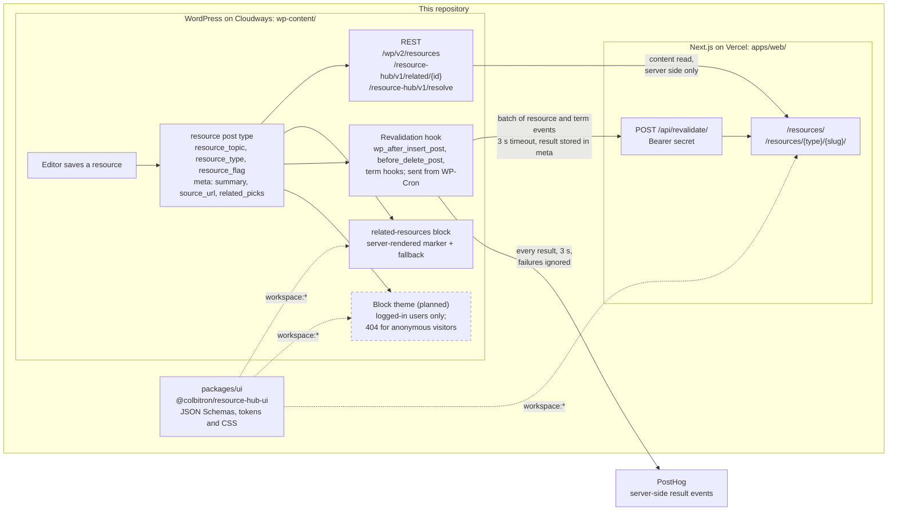

# Resource Hub

A headless WordPress demo in one repository ([ADR 0033](docs/adr/0033-one-repository-for-the-plugin-the-front-end-and-the-contract.md)): a WordPress plugin, `resource-hub`, with the `wp-env` environment it runs in; a Next.js front end on Vercel that reads the site over REST and is told when to revalidate; and the contract package both share. It is a demonstration of a pattern, written fresh, not production code.

The plugin models a filterable resources library: a `resource` post type with `resource_topic`, `resource_type`, and `resource_flag` taxonomies, REST-exposed meta (`summary`, `source_url`, `related_picks`), two custom REST routes (related items and old-slug resolution), one server-rendered Gutenberg block, and a hook that notifies the front end in batches whenever a public resource or one of its terms changes. The front end renders that library from its own server and rebuilds pages on demand.

## Layout

```
/                                        pnpm workspace root: .wp-env.json, CI, CLAUDE.md, this README
├─ wp-content/plugins/resource-hub-wp/   the WordPress plugin (its own CLAUDE.md)
├─ wp-content/themes/resource-hub/       the CMS's block theme, planned for slice 5; not here yet
├─ apps/web/                             the Next.js front end (its own README.md and CLAUDE.md)
├─ packages/ui/                          @colbitron/resource-hub-ui: the contract's JSON Schemas and shared styles
└─ docs/adr/                             every decision record, one sequence for the whole project
```

The planned theme is a full block theme kept in sync with the front end through the `packages/ui` tokens and CSS. Like any theme on this CMS it is for editors and logged-in previews: anonymous visitors get a 404 ([ADR 0031](docs/adr/0031-cms-theme-pages-are-for-logged-in-users.md)).

## Status

Scaffold complete; features in progress. Everything below the line exists and is green in CI.

| Piece | State |
|---|---|
| wp-env environment, PHP 8.4, latest WordPress | done |
| Composer, PSR-4 autoloader, PHPCS, PHPUnit, Playwright | done |
| Block build toolchain (`@wordpress/scripts`) | done |
| GitHub Actions gate | done |
| Hosted CMS on Cloudways, PHP 8.4, HTTPS ([ADR 0005](docs/adr/0005-hosted-wordpress-on-cloudways.md)) | done |
| Deploy job from `main` to the host | done |
| `resource` post type and taxonomies ([ADR 0007](docs/adr/0007-one-post-type-with-a-type-taxonomy.md), [ADR 0009](docs/adr/0009-featured-is-a-term-not-meta.md)) | done |
| REST-registered meta with sanitizers and an editor panel ([ADR 0008](docs/adr/0008-meta-in-code-not-acf.md)) | done |
| `wp resource-hub seed` sample content | done |
| `GET /resource-hub/v1/related/{id}` | pending |
| `resource-hub/related-resources` block | pending |
| Revalidation hook and admin notice | pending |
| Next.js front end scaffold in `apps/web` | done |
| Front-end production deploy through a Vercel deploy hook | pending |
| CMS block theme | planned |

## Architecture



The front end reads content through the core REST API and the two custom routes, always from the Next.js server, so the CMS's address never reaches a browser; it rewrites CMS links to its own domain and CMS images to its `/media/` path. WordPress pushes a small bearer-authenticated batch when content changes, from a cron request after the save, so it never renders pages for the front end and the editor never waits on it; each result is stored on the resources it covered and, when configured, sent to PostHog. The CMS's own theme pages exist only for logged-in users and previews, and answer anyone else with a 404. The block renders on the server so the editor preview and those pages share one template, and its output is a marker the front end swaps for its own component. Both sides take the schemas and the shared styles from `packages/ui` through the pnpm workspace, so a contract change is one pull request; the package is never published ([ADR 0041](docs/adr/0041-the-shared-package-is-a-workspace-dependency.md)). The theme those pages will use is planned for slice 5 (dashed above).

## Getting started

Requirements on the host: Docker, Node 24, pnpm. PHP, Composer, and WP-CLI run inside the containers.

```sh
pnpm install            # one workspace: the plugin, the front end and packages/ui
pnpm env:start          # WordPress at http://localhost:8888, tests site at :8889
pnpm composer install   # inside the container; vendor/ lands in the plugin directory
pnpm build              # compiles the block and editor-panel scripts into the plugin's build/
pnpm wp resource-hub seed   # optional: fictional sample resources to list and filter
```

Log in at `http://localhost:8888/wp-admin` with `admin` / `password`.

Activating the plugin makes the pretty permalinks for `/resources/` and single resources work without a visit to Settings > Permalinks: it deletes the stored rewrite rules, and WordPress regenerates them on the next request (`flush_rewrite_rules()` itself is forbidden by the VIP ruleset). If the URLs 404 after a deploy that did not reactivate the plugin, `pnpm wp rewrite flush` (or `wp rewrite flush` on the host) is the manual equivalent.

The revalidation secret and front-end URL are read from `RESOURCE_HUB_FRONTEND_URL` and `RESOURCE_HUB_REVALIDATE_SECRET`, and results logging from the optional `RESOURCE_HUB_POSTHOG_KEY` and `RESOURCE_HUB_POSTHOG_HOST` (skipped when unset). Locally, define them in a gitignored `.wp-env.override.json` under `config`; on the host they are `define()`d in `wp-config.php`. They are never committed.

## Commands

| Command | Does |
|---|---|
| `pnpm env:start` / `env:stop` / `env:destroy` | wp-env lifecycle |
| `pnpm wp <args>` / `pnpm wp:tests <args>` | WP-CLI in the dev or tests container |
| `pnpm wp resource-hub seed` | Seeds types, topics, and 12 fictional resources on the dev site; `--count=<n>` up to 16; safe to rerun |
| `pnpm composer <args>` | Composer in the dev container |
| `pnpm lint` / `pnpm lint:fix` | PHPCS / PHPCBF |
| `pnpm lint:js` / `pnpm format` | ESLint and Prettier with the WordPress presets |
| `pnpm build` / `pnpm start` | Block build, once or watching |
| `pnpm test:php` | PHPUnit in the tests container |
| `pnpm test:e2e` / `pnpm test:e2e:debug` | Playwright against the tests site |
| `pnpm test:schemas` | The contract schema test in `packages/ui` |
| `pnpm web:dev` / `web:lint` / `web:typecheck` / `web:build` | The Next.js app in `apps/web` |

The wp-env scripts run from the root, where `.wp-env.json` is; `build`, `lint:js`, `format`, `test:e2e` and the `web:*` scripts delegate with `pnpm --filter` to the plugin package (`wp-content/plugins/resource-hub-wp/package.json`) or the app, which also accept the same commands from their own directories.

## Testing

Three gates, all run by `.github/workflows/ci.yml` on every pull request and on every push to `main`:

- **PHPCS** on the WordPress Coding Standards and the WordPress VIP Minimum ruleset, with the non-conflicting parts of PSR-12 ([ADR 0003](docs/adr/0003-wordpress-coding-standards-over-psr-12.md), [ADR 0006](docs/adr/0006-vip-minimum-ruleset-in-the-gate.md)).
- **PHPUnit 9.6** inside the WordPress core test library that wp-env provides ([ADR 0004](docs/adr/0004-phpunit-9-matches-the-core-test-library.md)).
- **Playwright** against the wp-env tests site on port 8889, using the WordPress e2e utilities.

One interaction to know about: the PHPUnit bootstrap drops and reinstalls the tests database, which deactivates every plugin on the tests site. CI runs PHPUnit before Playwright, and a shared worker-scoped fixture (`wp-content/plugins/resource-hub-wp/tests/e2e/fixtures.js`) activates the plugin before any spec runs rather than assuming it.

The compiled output in the plugin's `build/` (the block and the editor sidebar panel) is not committed; CI and the start command build it. The plugin's `webpack.config.js` extends the `@wordpress/scripts` config with the one non-block entry under `editor/`.

A second CI job, `web`, lints, typechecks and builds the front end in `apps/web` on the same triggers. It needs no secrets, because the scaffold makes no CMS calls at build time.

## Deployment

The `deploy` job in `.github/workflows/ci.yml` publishes the plugin to the Cloudways host ([ADR 0005](docs/adr/0005-hosted-wordpress-on-cloudways.md)). It runs only after the gate passes, and only for a push to `main` or a manual `workflow_dispatch` on `main` or a tag. Pull requests and other branches never deploy. One deploy runs at a time, and a running deploy is never cancelled. GitHub keeps only one waiting run, so a newer merge replaces any run still waiting; that is safe because the newer commit includes the older one.

From a fresh checkout it builds the block, runs `composer install --no-dev` in `wp-content/plugins/resource-hub-wp/`, and rsyncs that directory over SSH into the plugin directory on the host with `--delete-delay --delay-updates`, so changed files are swapped in together at the end and stale ones are removed after that. The rsync is an allowlist, so the host receives only what WordPress loads: `resource-hub.php`, `src/`, `build/`, and `vendor/`. Everything else stays behind by default: the block source in `blocks/`, tests, docs, toolchain config, lockfiles, and manifests. A new runtime file or directory has to be added to the allowlist in the workflow. It then activates the plugin with WP-CLI if it is not already active, reads the site's `home` URL over SSH, and requests `{home}/wp-json/` to check that the REST API answers. WP-CLI runs from the WordPress root, not the plugin directory, because the host's `wp-config.php` requires `wp-salt.php` by a relative path, which resolves against the working directory.

Five repository secrets feed it:

| Secret | Holds |
|---|---|
| `DEPLOY_SSH_KEY` | Private half of a key used only for deploys |
| `DEPLOY_HOST` | SSH hostname or IP of the server |
| `DEPLOY_USER` | SSH user |
| `DEPLOY_PATH` | Absolute path of the plugin directory itself, ending in `wp-content/plugins/resource-hub-wp` |
| `DEPLOY_KNOWN_HOSTS` | The server's pinned host key line or lines, so the runner never trusts on first use |

The front end deploys after the CMS. The CMS deploy needs only the CMS gate, so a front-end failure never blocks a CMS deploy or a rollback. A later job (slice 3) will deploy `apps/web` to Vercel production through a deploy hook once the CMS deploy and the `web` job have both passed; on Vercel the Root Directory is `apps/web`, automatic production deploys from Git are off, and pull requests still get preview deploys. Contract changes are additive, so the front end never depends on something the live CMS does not have yet.

**Rolling back** means redeploying an earlier commit from a tag. Tag the good commit, push the tag, then dispatch the workflow on it: `git tag rollback-<date> <sha> && git push origin rollback-<date>`, then `gh workflow run ci.yml --ref rollback-<date>`. Pushing a tag does not start CI, because the push trigger covers only `main`, so a tag deploy always takes that manual dispatch. The run goes through the gate before deploying. The tagged commit must contain this deploy job, so commits from before it was added cannot be redeployed this way.

## Decisions

Each real decision has a record under [`docs/adr/`](docs/adr/). One sentence each:

- [0001](docs/adr/0001-wp-env-for-the-local-environment.md) wp-env on Docker is the only environment, so the laptop and CI run the same test setup.
- [0002](docs/adr/0002-repository-root-is-the-plugin.md) The repository root is the plugin, so one mount serves wp-env, Composer, and CI. Superseded by 0033.
- [0003](docs/adr/0003-wordpress-coding-standards-over-psr-12.md) WordPress Coding Standards win over PSR-12 where they conflict; each exclusion names the conflict.
- [0004](docs/adr/0004-phpunit-9-matches-the-core-test-library.md) PHPUnit stays on 9.6 because the WordPress core test library tops out there.
- [0005](docs/adr/0005-hosted-wordpress-on-cloudways.md) The CMS is hosted on Cloudways so Vercel can reach it over HTTPS; PHP is pinned to 8.4 to match.
- [0006](docs/adr/0006-vip-minimum-ruleset-in-the-gate.md) The PHPCS gate adds WordPress VIP Minimum, not VIP-Go, whose relaxations assume VIP's own infrastructure.
- [0007](docs/adr/0007-one-post-type-with-a-type-taxonomy.md) One `resource` post type with a `resource_type` taxonomy, because core REST has no cross-type collection that returns full objects and filters by taxonomy, and the kinds share a shape today; types are a fixed list editors manage, topics are open.
- [0008](docs/adr/0008-meta-in-code-not-acf.md) Meta is registered in code with `register_post_meta()`, not ACF, because in a headless build every field is a developer change anyway and belongs in reviewed, tested code.
- [0009](docs/adr/0009-featured-is-a-term-not-meta.md) `featured` is a term in a code-managed `resource_flag` taxonomy, not boolean meta, because term relationships are indexed and meta-value filtering fails the slow-query sniff; `hierarchical` is what stops editors creating flags.
- [0010](docs/adr/0010-contract-as-json-schema-in-a-shared-package.md) The contract with the front end is JSON Schema in the shared `packages/ui` package, consumed by PHPUnit here and by Zod on the front end, because prose in two `CLAUDE.md` files drifts and a schema turns drift into a failing test on whichever side moved first.
- [0011](docs/adr/0011-revalidation-fires-on-wp-after-insert-post.md) Revalidation fires from `wp_after_insert_post` and `before_delete_post`, because `wp_after_insert_post` is the one hook that runs after terms and meta are saved on every write path, and a force delete never reaches it.
- [0012](docs/adr/0012-revalidation-is-sent-from-wp-cron.md) The request is sent from a WP-Cron single event with `spawn_cron()` and a payload built at schedule time, so the editor never waits and the result can still be recorded, even after trash renames the slug or a delete removes the post.
- [0013](docs/adr/0013-three-second-timeout-and-no-retries.md) The request times out at 3 seconds and is never retried, so the VIP timeout sniff passes with no ignore and the editor, who sees the failure, retries by saving.
- [0014](docs/adr/0014-one-php-request-is-one-batch.md) One PHP request sends one versioned batch of up to 25 deduplicated events, so a bulk edit is one request to the front end, not one per post.
- [0015](docs/adr/0015-five-resource-events.md) Resource events are `publish`, `update`, `unpublish`, `trash` and `delete`, describing the public state they concern, so the front end can tell refresh from remove for every way a resource leaves or changes.
- [0016](docs/adr/0016-previous-state-on-update.md) An `update` carries the previous slug, type and topics, because the listings and URL a resource just left also need revalidating.
- [0017](docs/adr/0017-term-events.md) Topic and type changes send term events through the same batch, because renaming or deleting a term changes pages without saving any resource.
- [0018](docs/adr/0018-revalidation-results-shown-in-the-editor.md) Results are stored in `_rh_last_revalidation` on every resource in the batch and shown by a post-save poll in the block editor and a hidden-by-default list column, because the send happens after the save has returned.
- [0019](docs/adr/0019-settings-page-is-a-status-page.md) The settings page is a status page that shows which configuration source is active and has a test button that sends a real `update` event for a chosen published resource, because the first question after a failure is what is configured and whether the front end answers a real payload.
- [0020](docs/adr/0020-related-is-picks-then-newest-in-topic.md) Related resources are editor picks first, then the newest published resources in the same topics, so editors can say what they mean and every resource is still covered.
- [0021](docs/adr/0021-related-route-returns-ids-only.md) The related route returns IDs and a reason only, so the front end renders related items with the same core request and card it uses everywhere.
- [0022](docs/adr/0022-related-results-in-a-salted-object-cache.md) The related route keeps its own salted object-cache entry, because core's query cache is emptied by every autosave on the site.
- [0023](docs/adr/0023-next-data-cache-is-the-only-http-cache.md) REST responses carry `no-cache` headers so Next.js's data cache is the only HTTP cache, because it is the only one revalidation can clear.
- [0024](docs/adr/0024-type-paths-mirrored-on-both-sites.md) Resource URLs are `/resources/[type]/[slug]/` on both sites, a resource has exactly one type, and listings filter by one type and one topic as path segments, so the URL shows the library's hierarchy, every listing can be prerendered, and the front end only strips the domain from links.
- [0025](docs/adr/0025-redirects-are-computed-308s-with-no-store.md) The front end's permanent redirects are computed single-hop 308s sent with `Cache-Control: no-store`, because browsers cache header-less permanent redirects and loop when a type changes back.
- [0026](docs/adr/0026-block-renders-a-marker-with-a-fallback.md) The block renders a `data-rh-block` marker around a fallback list, which the front end swaps for a server component, because HTML baked into a resource's body would go stale.
- [0027](docs/adr/0027-block-requires-a-topic.md) The block lists the newest resources in a required topic stored as a term ID, with `count` 1 to 10 and an editable `<h2>` heading, so it has one predictable job and survives a topic rename.
- [0028](docs/adr/0028-shared-styles-in-a-private-github-package.md) The block's styles are shared with the front end through `@colbitron/resource-hub-ui` as a private GitHub package, so the fallback and the swapped component look the same from one source; private because a public npm package would be discoverable as a general-use package. Superseded by 0041.
- [0029](docs/adr/0029-old-slugs-resolve-through-core.md) Old slugs resolve through core's `_wp_old_slug` data via a resolve route, so there is one record of slug history and the front end can redirect renamed resources.
- [0030](docs/adr/0030-related-merging-happens-in-the-route.md) Picks and topic fill are merged in the related route, not on the front end, so the merging rules live in one PHPUnit-tested place, the picks list stays in the REST `edit` context, and the answer is cached in Redis.
- [0031](docs/adr/0031-cms-theme-pages-are-for-logged-in-users.md) The CMS's theme pages are for logged-in users only and answer anonymous visitors with a 404, not a redirect, with `robots.txt` and `noindex, nofollow` on top, because the front end is the only public site and a redirecting CMS would be a second router.
- [0032](docs/adr/0032-revalidation-results-logged-to-posthog.md) Every revalidation result is also sent to PostHog as a server-side event when configured, because force deletes and term deletes leave nothing to store a result on and `error_log()` fails the VIP ruleset.
- [0033](docs/adr/0033-one-repository-for-the-plugin-the-front-end-and-the-contract.md) One repository holds the plugin (`wp-content/plugins/resource-hub-wp/`), the front end (`apps/web/`) and the contract package (`packages/ui/`), because a contract change is one change to all three and should be one pull request with one diff; the package becomes a workspace link instead of a published dependency.
- [0034](docs/adr/0034-filters-and-pagination-are-path-segments.md) The front end's filters and pagination are path segments, one topic and one type at a time, because reading `searchParams` makes an App Router page dynamic and path segments can be prerendered.
- [0035](docs/adr/0035-type-paths-with-a-computed-no-store-308.md) A resource lives at `/resources/[type]/[slug]/`, and a wrong type or an old slug gets a computed single-hop 308 with `Cache-Control: no-store`, because browsers cache header-less permanent redirects and loop when a type changes back.
- [0036](docs/adr/0036-cms-links-are-made-relative.md) The front end strips the CMS domain from every link in the HTML it renders, because the paths are mirrored and only the host differs, so one rule covers every link whoever wrote it.
- [0037](docs/adr/0037-block-marker-swapped-for-a-server-component.md) The block's marker is swapped for a `<RelatedResources>` server component on the Next.js server, so the list is revalidated by topic events instead of going stale inside a resource's body.
- [0038](docs/adr/0038-shared-styles-through-npm-rc.md) The front end installed the shared styles from the private GitHub package through a Vercel install variable, after a spike to prove it worked with pnpm. Superseded by 0041.
- [0039](docs/adr/0039-vercel-image-optimizer.md) Images go through Vercel's image optimizer within the plan's monthly allowance, with WordPress's own sizes proxied through Cloudflare as the fallback.
- [0040](docs/adr/0040-the-cms-url-never-reaches-the-browser.md) The CMS URL never reaches the browser: every CMS request is server-side, images go through a `/media/` rewrite, and rendered HTML is rewritten in one pass; this reduces exposure and is not a security boundary.
- [0041](docs/adr/0041-the-shared-package-is-a-workspace-dependency.md) `@colbitron/resource-hub-ui` is a `workspace:*` dependency and is never published, because every consumer lives in this repository; it supersedes 0028 and 0038.
- [0042](docs/adr/0042-phpunit-validates-payloads-against-the-shared-schemas.md) PHPUnit validates every revalidation payload against the shared schemas: `.wp-env.json` maps `packages/ui` into the containers and `opis/json-schema` reads draft 2020-12, so the PHP side fails on drift in the same pull request as the Node side.

## Contract with the front end

A contract change lands in one pull request that touches both sides and the schemas, and stays additive, so the front end never breaks against a CMS one deploy behind. The source of truth is the JSON Schema package in [`packages/ui/schemas/`](packages/ui/schemas/) ([ADR 0010](docs/adr/0010-contract-as-json-schema-in-a-shared-package.md)), with the semantics a schema cannot express in [`packages/ui/README.md`](packages/ui/README.md). In summary:

- **Read:** the core collection `GET /wp-json/wp/v2/resources?_embed&…` filtered by `resource_topic`, `resource_type` and `resource_flag`, single resources, and the three taxonomy endpoints. Meta is `summary` and `source_url`; `related_picks` is in the REST `edit` context only, for the editor's picker. Every read happens on the Next.js server, never in the browser. Two custom routes: `GET /wp-json/resource-hub/v1/related/{id}?count=n` returns `{ "items": [ { "id", "source": "pick" | "topic" } ] }`, already merged, and `GET /wp-json/resource-hub/v1/resolve?slug=…` maps a current or old slug to `{ "id", "type", "slug" }`. Both answer errors in core's `WP_Error` shape.
- **Revalidate:** `POST {FRONTEND_URL}/api/revalidate/` with `Authorization: Bearer {secret}` and a batch `{ "version": 1, "events": [ … ] }` of 1 to 25 events. Resource events are `publish`, `update`, `unpublish`, `trash` or `delete`, with `id`, `slug`, `rest_url`, `types` (exactly one), `topics` and `previous` (set only on `update`). Term events cover `create`, `update` and `delete` of `resource_topic` and `resource_type` terms. The front end answers `200 { "revalidated": [ … ] }`, or `400`, `401` (`unauthorized`) or `500` with `{ "error": "…" }`. The plugin stores the status and body in `_rh_last_revalidation` and shows them to the editor.
- **URLs:** both sites serve `/resources/`, `/resources/[type]/`, `/resources/topic/[topic]/`, `/resources/[type]/topic/[topic]/` and `/resources/[type]/[slug]/`, with a trailing slash and `…/page/[n]/` pagination; `topic` and `page` are never type slugs, and WordPress refuses them. Only the front end is public: the CMS's theme pages answer anonymous visitors with a 404 and never redirect. WordPress emits absolute CMS URLs; the front end strips the domain from links and rewrites images, in `content.rendered` too, to `/media/…`, a Next.js rewrite to the CMS's uploads.
- **Block and styles:** the related-resources block renders `<div data-rh-block="related-resources">` with `data-count`, `data-topic`, `data-topic-id` and `data-exclude` around a fallback list, which the front end swaps for its own component on its server; the class names and `tokens.css` come from `@colbitron/resource-hub-ui`, which both sides take through the workspace.

## License

GPL-2.0-or-later.
