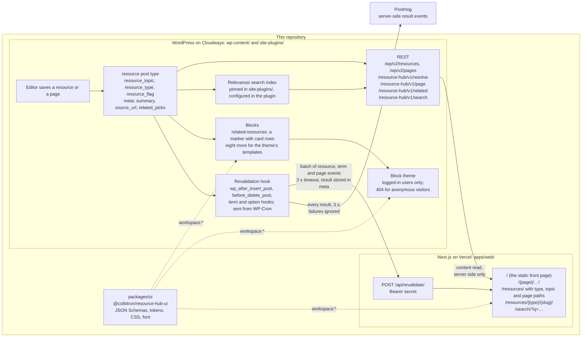

# Resource Hub

A headless WordPress demo in one repository ([ADR 0033](docs/adr/0033-one-repository-for-the-plugin-the-front-end-and-the-contract.md)). It holds a WordPress plugin, `resource-hub`, with the `wp-env` environment it runs in; a Next.js front end on Vercel that reads the site over REST and rebuilds pages when WordPress tells it to; and a contract package that both sides share. It demonstrates a pattern and was written fresh for that purpose. It is not production code.

The site is a filterable library of resources. The plugin defines a `resource` post type with three taxonomies (`resource_topic`, `resource_type` and `resource_flag`) and REST-exposed meta (`summary`, `source_url`, and the editor's `related_picks`). It adds four REST routes:

- **resolve:** finds a resource by an old slug.
- **page:** looks up a page by its path.
- **related:** returns a resource's related resources, the editor's picks first and then the newest resources that share a topic.
- **search:** searches the published resources and pages.

When a public resource, one of its terms or a page changes, the plugin sends the front end a batch of events. The front end renders the library, the CMS's static front page at `/`, every other published page at its path, and a search page at `/search/`. It clears the cached pages each batch affects, and they rebuild on demand. The `resource-hub/related-resources` block lists the newest resources in one topic inside any page or resource body. The CMS renders it as a marker, which the front end replaces with its own list.

## Architecture



The front end reads content from the core REST API and the custom routes, always from the Next.js server, so the CMS's address never reaches a browser ([ADR 0040](docs/adr/0040-the-cms-url-never-reaches-the-browser.md)). It rewrites CMS links to its own domain and CMS images to its `/media/` path.

When content changes, WordPress sends a small bearer-authenticated batch of events to the front end. It sends the batch from a cron request after the save, so the editor never waits for it, and WordPress never renders pages for the front end. The result of each send is stored on the objects it covered and, when PostHog is configured, sent there too.

The CMS's own block theme is for editors and logged-in previews. Anonymous visitors get a 404 rendered with the theme's 404 template, because the front end is the only public site ([ADR 0031](docs/adr/0031-cms-theme-pages-are-for-logged-in-users.md)). The theme renders with the `packages/ui` tokens and CSS and uses the plugin's blocks, so a logged-in preview looks like the front end. The differences that remain are listed in [its README](wp-content/themes/resource-hub/README.md), under "Not built yet".

Search runs on Relevanssi, the free WordPress search plugin. It is not part of this codebase: Composer installs a pinned version from wpackagist through `site-plugins/`, and the plugin sets Relevanssi's options in code. The plugin also works without it.

Both sides take the schemas and the shared styles from `packages/ui` through the pnpm workspace, so a contract change is one pull request. The package is never published.

## Layout

```
/                                        pnpm workspace root: .wp-env.json, CLAUDE.md, this README
├─ wp-content/plugins/resource-hub-wp/   the WordPress plugin (its own README.md and CLAUDE.md)
├─ wp-content/themes/resource-hub/       the CMS's block theme, for editors and logged-in previews (its own README.md)
├─ site-plugins/                         Composer project for third-party WordPress plugins; today only Relevanssi (its own README.md)
├─ apps/web/                             the Next.js front end (its own README.md and CLAUDE.md)
├─ packages/ui/                          @colbitron/resource-hub-ui: the contract's JSON Schemas, shared styles, the font and DESIGN.md
├─ tools/featured-images/                generates and imports the sample resources' featured images (its own README.md)
├─ docs/adr/                             architecture decision records, one sequence for the whole project
├─ docs/architecture/                    how revalidation and caching work
├─ docs/runbooks/                        deploying, rolling back, rotating secrets
├─ .depot/                               CI on Depot CI: the workflows and the scripts they run
├─ .github/workflows/                    the one workflow on GitHub Actions: the ADR check
└─ .claude/rules/                        path-scoped rules for coding agents, loaded when a matching file is touched
```

## What is built

Everything marked built is on `main` and passes CI.

| Part | State |
|---|---|
| Local environment: wp-env with PHP 8.4 and the latest WordPress; Relevanssi installed from `site-plugins/` | built |
| Plugin tooling: Composer with a PSR-4 autoloader, PHPCS, PHPUnit, Playwright, and `@wordpress/scripts` for the blocks | built |
| Content model: the `resource` post type and its taxonomies, exactly one type per resource ([ADR 0007](docs/adr/0007-one-post-type-with-a-type-taxonomy.md), [ADR 0024](docs/adr/0024-type-paths-mirrored-on-both-sites.md)), and meta registered in code with sanitizers and an editor panel ([ADR 0008](docs/adr/0008-meta-in-code-not-acf.md)) | built |
| REST routes: resolve, page, related (with a salted object cache for the related list) and search | built |
| Revalidation: the hook, the WP-Cron send, the editor notice, the list column, the term notice, the settings status page, and the optional PostHog events ([ADR 0011](docs/adr/0011-revalidation-fires-on-wp-after-insert-post.md)) | built |
| CMS lockdown: theme pages for logged-in users only ([ADR 0031](docs/adr/0031-cms-theme-pages-are-for-logged-in-users.md)); XML-RPC, trackbacks and pingbacks, update-service pings and enclosure fetches all off | built |
| Blocks: the related-resources block, the editor's picker for a resource's related picks, and eight blocks the theme's templates use | built |
| WP-CLI commands: `wp resource-hub seed`, `decode-slugs` and `search-index` | built |
| Contract package: the JSON Schemas with their own test, checked by PHPUnit on the CMS and by Zod on the front end ([ADR 0010](docs/adr/0010-contract-as-json-schema-in-a-shared-package.md)); the shared tokens, CSS and font | built |
| Front end: the library's listings, the resource page with its related section, the CMS's pages ([ADR 0052](docs/adr/0052-the-front-end-renders-the-cms-pages.md)), `/search/`, the revalidate route, one pass over rendered CMS HTML, and incremental static regeneration (ISR) throughout ([ADR 0043](docs/adr/0043-fetch-cache-with-tags-without-cache-components.md), [ADR 0025](docs/adr/0025-permanent-redirects-are-computed-and-never-kept-by-browsers.md)) | built |
| CMS block theme: every template in the front end's markup and styles, including the resource page, the collection pages and the System / Light / Dark control, held to the front end by markup fixtures and computed-style and screenshot checks | built |
| CI on Depot CI ([ADR 0053](docs/adr/0053-ci-runs-on-depot-ci.md)) | built |
| Hosting and deploys: the CMS on Cloudways ([ADR 0005](docs/adr/0005-hosted-wordpress-on-cloudways.md)) and the front end on Vercel ([ADR 0051](docs/adr/0051-front-end-production-deploys-through-a-vercel-deploy-hook.md)), both deployed from `main` | built |
| The theme's search template and header search control ([issue #115](https://github.com/Colbitron/resource-hub-wp/issues/115)), after a redesign of that control ([issue #128](https://github.com/Colbitron/resource-hub-wp/issues/128)) | open |
| Lab measurement in a real browser ([issue #85](https://github.com/Colbitron/resource-hub-wp/issues/85)) and a plan for the related list at a larger scale ([issue #87](https://github.com/Colbitron/resource-hub-wp/issues/87)) | open |
| The theme's remaining differences from the front end, listed in its README | open |

## Getting started

Requirements on the host: Docker, Node 24 and pnpm. PHP, Composer and WP-CLI run inside the wp-env containers.

```sh
pnpm install            # one workspace: the plugin, the theme, the front end and packages/ui
pnpm env:start          # WordPress at http://localhost:8888, the tests site at :8889; installs and activates Relevanssi
pnpm composer install   # runs in the container; vendor/ lands in the plugin directory
pnpm build              # builds the blocks and editor scripts into the plugin's build/, and the theme's assets into its build/
pnpm wp resource-hub seed   # optional: fictional sample resources to list and filter
pnpm wp resource-hub search-index --force   # rebuilds the search index after seeding
```

`pnpm env:start` also builds the search index, but only when it is out of date, which is why the last line forces a rebuild.

Log in at `http://localhost:8888/wp-admin` with `admin` / `password`. That is wp-env's default login for the local site only. The plugin's [README](wp-content/plugins/resource-hub-wp/README.md) covers configuration, the WP-CLI commands and testing. The front end's [README](apps/web/README.md) covers `apps/web`.

## Commands

| Command | Does |
|---|---|
| `pnpm env:start` / `env:stop` / `env:destroy` | wp-env lifecycle |
| `pnpm wp <args>` / `pnpm wp:tests <args>` | WP-CLI in the dev or tests container |
| `pnpm wp resource-hub seed` / `decode-slugs` / `search-index` | The plugin's commands; see its README |
| `pnpm composer <args>` | Composer in the dev container, in the plugin directory |
| `pnpm composer:site <args>` | Composer in the dev container, in `site-plugins/` (third-party plugins; see its README) |
| `pnpm lint` / `pnpm lint:fix` | PHPCS / PHPCBF |
| `pnpm lint:js` / `pnpm format` | ESLint and Prettier with the WordPress presets |
| `pnpm build` / `pnpm start` | Block build, once or watching; `pnpm build` also builds the theme's assets |
| `pnpm test:php` | PHPUnit in the tests container |
| `pnpm test:e2e` / `pnpm test:e2e:debug` | Playwright against the tests site |
| `pnpm test:schemas` | The `packages/ui` tests: the contract schemas, and the stylesheets' contrast and design-doc checks |
| `pnpm web:dev` / `web:lint` / `web:typecheck` / `web:test` / `web:test:e2e` / `web:build` | The Next.js app in `apps/web` |

The wp-env scripts run from the root, where `.wp-env.json` is. The rest run the matching script in the plugin, theme or app package through `pnpm --filter`, and those scripts also run from each package's own directory.

## Testing

CI runs on Depot CI ([ADR 0053](docs/adr/0053-ci-runs-on-depot-ci.md)), from `.depot/workflows/`, written in GitHub Actions' workflow syntax. Its checks appear on pull requests through Depot's GitHub app. A push to `main` runs every job in `.depot/workflows/ci.yml`. A pull request runs only the jobs its changed paths need ([`docs/runbooks/deploy.md`](docs/runbooks/deploy.md), "Which jobs a pull request runs").

The jobs:

- **The CMS gate:** the schema test, PHPCS, PHPUnit, then Playwright against the wp-env tests site. PHPUnit reinstalls the tests site, so it runs before Playwright, and the Playwright specs activate the plugin themselves.
- **The front end's checks:** lint, typecheck, unit tests and the production build.
- **The front end's end-to-end suite:** Playwright against a mock CMS, with an axe accessibility scan.
- **Screenshots:** pixel comparisons of the design specimen against committed baselines, and a check that the committed brand images match a fresh render.
- **Lighthouse CI,** on `main` only, in five shards by URL, with one more job that merges their medians.

`.depot/workflows/preview-lighthouse.yml` runs Lighthouse against the Vercel preview of each pull request that touches the front end, once Vercel reports the preview deployed, and posts the result as a comment. It never blocks a merge. `.depot/workflows/screenshot-baselines.yml` is run by hand to regenerate the screenshot baselines. The details are in the plugin's README and in [`apps/web/e2e/README.md`](apps/web/e2e/README.md).

One workflow runs on GitHub Actions: `.github/workflows/adr-approval.yml`. It fails a pull request that changes an ADR, or a file that guards the ADRs, unless the pull request carries the `adr-approved` label. A copy in `.depot/workflows/` runs the same check on Depot CI. The rules behind it are in `.claude/rules/adr.md`.

## Deployment

Nothing is deployed by hand. A push to `main` runs the gate, then deploys the CMS:

1. CI builds the blocks and the theme's assets, and Composer installs the plugin's production dependencies and Relevanssi, in the official `composer:2` container image, pinned by digest.
2. Relevanssi's installed files are checked against the checksums WordPress.org publishes for that version.
3. Relevanssi, the plugin and the theme are copied to the host by rsync over SSH, each from an allowlist of files.
4. WP-CLI activates them, flushes the rewrite rules, rebuilds the search index if it is out of date, and checks that the REST API answers.

Once the CMS is deployed and every front-end job has passed, CI starts the front end's Vercel production build through a deploy hook ([ADR 0051](docs/adr/0051-front-end-production-deploys-through-a-vercel-deploy-hook.md)). The CMS always goes first, so the front end never goes live ahead of the CMS it reads. That ordering is why contract changes must be additive. Pull requests never deploy; they get Vercel previews. The secrets, the rollback steps for each side, secret rotation and the host notes are in [`docs/runbooks/deploy.md`](docs/runbooks/deploy.md).

## Decisions

The fourteen records under [`docs/adr/`](docs/adr/) cover the decisions that would be expensive to undo. Their numbers have gaps: early in the build most choices got a record of their own, and the set was later cut down to the hard-to-reverse ones. Some of the removed records were folded into one that remains, which names them in its `merges:` frontmatter. The others were deleted, and what was still true in them moved to the docblocks, READMEs and topic pages. The remaining records kept their numbers.

Everything else is explained beside what it describes: [`docs/architecture/revalidation.md`](docs/architecture/revalidation.md) (how a change reaches the front end), [`docs/architecture/caching.md`](docs/architecture/caching.md) (caching, URLs and redirects, with measurements), the [deploy runbook](docs/runbooks/deploy.md), the contract in [`packages/ui/README.md`](packages/ui/README.md), the visual system in [`packages/ui/DESIGN.md`](packages/ui/DESIGN.md), and the docblocks.

- [0005](docs/adr/0005-hosted-wordpress-on-cloudways.md) The CMS is hosted on Cloudways so Vercel can reach it over HTTPS, with PHP pinned to 8.4 to match.
- [0007](docs/adr/0007-one-post-type-with-a-type-taxonomy.md) There is one `resource` post type with a `resource_type` taxonomy, because core REST has no cross-type collection that filters by taxonomy. `featured` is a term in a code-managed `resource_flag` taxonomy, not meta: term relationships are indexed, and a `hierarchical` taxonomy keeps editors from creating new flags.
- [0008](docs/adr/0008-meta-in-code-not-acf.md) Meta is registered in code with `register_post_meta()`, not ACF, because in a headless build every field needs a developer change anyway.
- [0010](docs/adr/0010-contract-as-json-schema-in-a-shared-package.md) The contract is JSON Schema in the shared package, checked by PHPUnit and by Zod, because prose drifts and a schema turns drift into a failing test.
- [0011](docs/adr/0011-revalidation-fires-on-wp-after-insert-post.md) Revalidation fires from `wp_after_insert_post` and `before_delete_post`, the hooks that see terms and meta on every write path, and is sent from a WP-Cron event so the editor never waits.
- [0024](docs/adr/0024-type-paths-mirrored-on-both-sites.md) Resource URLs are `/resources/[type]/[slug]/` on both sites, a resource has exactly one type, and filters and pagination are path segments so every listing can be prerendered.
- [0025](docs/adr/0025-permanent-redirects-are-computed-and-never-kept-by-browsers.md) Permanent redirects are computed single-hop 308s with a cache header that keeps browsers from holding them, because browsers cache redirects that have no cache header and then loop when a resource's type changes back.
- [0031](docs/adr/0031-cms-theme-pages-are-for-logged-in-users.md) The CMS's theme pages are for logged-in users only and answer anonymous visitors with a 404, not a redirect, because the front end is the only public site.
- [0033](docs/adr/0033-one-repository-for-the-plugin-the-front-end-and-the-contract.md) One repository and one pnpm workspace hold the plugin, the front end and the contract package, which is never published, with wp-env as the only local environment.
- [0040](docs/adr/0040-the-cms-url-never-reaches-the-browser.md) The CMS URL never reaches the browser: reads happen on the server, images go through a `/media/` rewrite, and one pass rewrites links in rendered HTML. This limits exposure; it is not a security boundary.
- [0043](docs/adr/0043-fetch-cache-with-tags-without-cache-components.md) The caching model: the `fetch` Data Cache with tags is the only HTTP cache, cleared by the union of each event's current and previous state. The build prerenders a bounded set of pages when the CMS answers and does not fail when it doesn't.
- [0051](docs/adr/0051-front-end-production-deploys-through-a-vercel-deploy-hook.md) The front end's production deploy is a fire-and-forget Vercel deploy hook, called by CI after the CMS deploy and every front-end job have passed.
- [0052](docs/adr/0052-the-front-end-renders-the-cms-pages.md) The front end renders the CMS's pages. It learns the page tree through one plugin route that looks pages up by path, and hears of changes through a `page` event and one `pages` tag.
- [0053](docs/adr/0053-ci-runs-on-depot-ci.md) CI, including the deploys, runs on Depot CI, because GitHub Actions' free minutes ran out and an Actions outage would stop every merge and deploy.

## Contract with the front end

[`packages/ui/README.md`](packages/ui/README.md) is the contract's only full statement, and the JSON Schemas in [`packages/ui/schemas/`](packages/ui/schemas/) are its source of truth. In short: the front end reads the core REST API and the custom routes on its server; WordPress POSTs a bearer-authenticated batch of events to `/api/revalidate/`; public URLs are the same on both sites; and a contract change is one additive pull request.

## License

Copyright (C) 2026 Colby Hill. Licensed under the GNU General Public License, version 2 or (at your option) any later version (GPL-2.0-or-later); the full text of version 2 is in [`LICENSE`](LICENSE). The Colbination name and mark (`apps/web/app/icon.svg`, its drawing in `apps/web/components/Brand.tsx`, and the icons and share image rendered from it, `favicon.ico`, `icon.png`, `apple-icon.png` and `opengraph-image.png` in `apps/web/app/`) are not covered by that license: all rights reserved. The Figtree font in `packages/ui/fonts/` is under its own license, the SIL Open Font License 1.1 ([`LICENSE-Figtree.txt`](packages/ui/fonts/LICENSE-Figtree.txt)).
