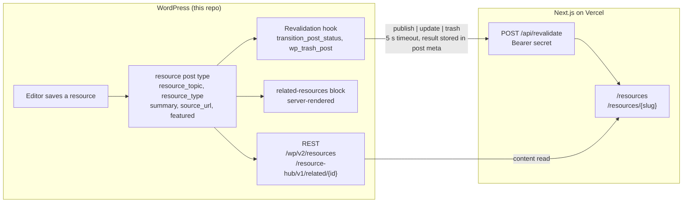

# Resource Hub (WordPress side)

The CMS half of a two-repository headless WordPress demo. This repository is a WordPress plugin, `resource-hub`, plus the `wp-env` environment it runs in. The other half, [`resource-hub-next`](../resource-hub-next), is a Next.js front end on Vercel that reads this site over REST and is told when to revalidate.

The plugin models a filterable resources library: a `resource` post type with `resource_topic` and `resource_type` taxonomies, REST-exposed meta, one custom REST route for related items, one server-rendered Gutenberg block, and a hook that notifies the front end on every publish, update, and trash.

## Status

Scaffold complete; features in progress. Everything below the line exists and is green in CI.

| Piece | State |
|---|---|
| wp-env environment, PHP 8.4, latest WordPress | done |
| Composer, PSR-4 autoloader, PHPCS, PHPUnit, Playwright | done |
| Block build toolchain (`@wordpress/scripts`) | done |
| GitHub Actions gate | done |
| Hosted CMS on Cloudways, PHP 8.4, HTTPS ([ADR 0005](docs/adr/0005-hosted-wordpress-on-cloudways.md)) | done |
| Deploy job from `main` to the host | pending |
| `resource` post type and taxonomies | pending |
| REST-registered meta with sanitizers | pending |
| `GET /resource-hub/v1/related/{id}` | pending |
| `resource-hub/related-resources` block | pending |
| Revalidation hook and admin notice | pending |

## Architecture



The front end reads content through the core REST API and the one custom route. WordPress pushes a small signed notification when content changes; it never renders pages for the front end and never waits on it. The block renders on the server so the editor preview and the classic front end share one template.

## Getting started

Requirements on the host: Docker, Node 24, pnpm. PHP, Composer, and WP-CLI run inside the containers.

```sh
pnpm install
pnpm env:start          # WordPress at http://localhost:8888, tests site at :8889
pnpm composer install   # inside the container; vendor/ lands in the repo
pnpm build              # compiles the block editor script into build/
```

Log in at `http://localhost:8888/wp-admin` with `admin` / `password`.

The revalidation secret and front-end URL are read from `RESOURCE_HUB_FRONTEND_URL` and `RESOURCE_HUB_REVALIDATE_SECRET`. Locally, define them in a gitignored `.wp-env.override.json` under `config`; on the host they are `define()`d in `wp-config.php`. They are never committed.

## Commands

| Command | Does |
|---|---|
| `pnpm env:start` / `env:stop` / `env:destroy` | wp-env lifecycle |
| `pnpm wp <args>` / `pnpm wp:tests <args>` | WP-CLI in the dev or tests container |
| `pnpm composer <args>` | Composer in the dev container |
| `pnpm lint` / `pnpm lint:fix` | PHPCS / PHPCBF |
| `pnpm lint:js` / `pnpm format` | ESLint and Prettier with the WordPress presets |
| `pnpm build` / `pnpm start` | Block build, once or watching |
| `pnpm test:php` | PHPUnit in the tests container |
| `pnpm test:e2e` / `pnpm test:e2e:debug` | Playwright against the tests site |

## Testing

Three gates, all run by `.github/workflows/ci.yml` on every pull request and on every push to `main`:

- **PHPCS** on the WordPress Coding Standards with the non-conflicting parts of PSR-12 ([ADR 0003](docs/adr/0003-wordpress-coding-standards-over-psr-12.md)).
- **PHPUnit 9.6** inside the WordPress core test library that wp-env provides ([ADR 0004](docs/adr/0004-phpunit-9-matches-the-core-test-library.md)).
- **Playwright** against the wp-env tests site on port 8889, using the WordPress e2e utilities.

One interaction to know about: the PHPUnit bootstrap drops and reinstalls the tests database, which deactivates every plugin on the tests site. CI runs PHPUnit before Playwright, and every Playwright spec activates the plugin in a `beforeAll` rather than assuming it.

The block's compiled output in `build/` is not committed; CI and the start command build it.

## Decisions

Each real decision has a record under [`docs/adr/`](docs/adr/). One sentence each:

- [0001](docs/adr/0001-wp-env-for-the-local-environment.md) wp-env on Docker is the only environment, so the laptop and CI run the same test setup.
- [0002](docs/adr/0002-repository-root-is-the-plugin.md) The repository root is the plugin, so one mount serves wp-env, Composer, and CI.
- [0003](docs/adr/0003-wordpress-coding-standards-over-psr-12.md) WordPress Coding Standards win over PSR-12 where they conflict; each exclusion names the conflict.
- [0004](docs/adr/0004-phpunit-9-matches-the-core-test-library.md) PHPUnit stays on 9.6 because the WordPress core test library tops out there.
- [0005](docs/adr/0005-hosted-wordpress-on-cloudways.md) The CMS is hosted on Cloudways so Vercel can reach it over HTTPS; PHP is pinned to 8.4 to match.

Decisions still to be made as the features land: the custom REST route versus filtering on the client, `transition_post_status` versus `save_post` for the revalidation hook, server-rendered versus React-rendered block, and the cache strategy for the related query.

## Contract with the front end

Both repositories change together when this changes.

- **Read:** `GET /wp-json/wp/v2/resources?_embed&per_page=…&resource_topic=…&resource_type=…`, `GET /wp-json/wp/v2/resources/{id}`, the taxonomy endpoints, and `GET /wp-json/resource-hub/v1/related/{id}?count=3`.
- **Revalidate:** `POST {FRONTEND_URL}/api/revalidate` with `Authorization: Bearer {secret}` and a JSON body of `type`, `event`, `id`, `slug`, `rest_url`, `topics`, and `types`. The front end answers `200` with the paths it revalidated, `400` for a malformed body, `401` for a bad bearer, or `500` on failure. The plugin stores the status and body in post meta and shows them to the editor as an admin notice.

## License

GPL-2.0-or-later.
