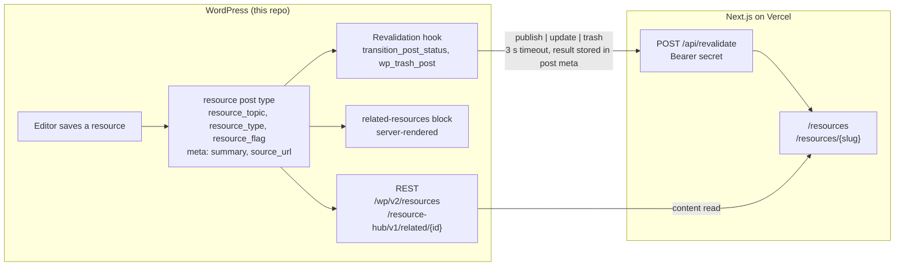

# Resource Hub (WordPress side)

The CMS half of a two-repository headless WordPress demo. This repository is a WordPress plugin, `resource-hub`, plus the `wp-env` environment it runs in. The other half, [`resource-hub-next`](../resource-hub-next), is a Next.js front end on Vercel that reads this site over REST and is told when to revalidate.

The plugin models a filterable resources library: a `resource` post type with `resource_topic`, `resource_type`, and `resource_flag` taxonomies, REST-exposed meta (`summary`, `source_url`), one custom REST route for related items, one server-rendered Gutenberg block, and a hook that notifies the front end on every publish, update, and trash.

## Status

Scaffold complete; features in progress. Everything below the line exists and is green in CI.

| Piece | State |
|---|---|
| wp-env environment, PHP 8.4, latest WordPress | done |
| Composer, PSR-4 autoloader, PHPCS, PHPUnit, Playwright | done |
| Block build toolchain (`@wordpress/scripts`) | done |
| GitHub Actions gate | done |
| Hosted CMS on Cloudways, PHP 8.4, HTTPS ([ADR 0005](docs/adr/0005-hosted-wordpress-on-cloudways.md)) | done |
| Deploy job from `main` to the host | pending |
| `resource` post type and taxonomies ([ADR 0007](docs/adr/0007-one-post-type-with-a-type-taxonomy.md), [ADR 0009](docs/adr/0009-featured-is-a-term-not-meta.md)) | done |
| REST-registered meta with sanitizers and an editor panel ([ADR 0008](docs/adr/0008-meta-in-code-not-acf.md)) | done |
| `wp resource-hub seed` sample content | done |
| `GET /resource-hub/v1/related/{id}` | pending |
| `resource-hub/related-resources` block | pending |
| Revalidation hook and admin notice | pending |

## Architecture



The front end reads content through the core REST API and the one custom route. WordPress pushes a small signed notification when content changes; it never renders pages for the front end and never waits on it. The block renders on the server so the editor preview and the classic front end share one template.

## Getting started

Requirements on the host: Docker, Node 24, pnpm. PHP, Composer, and WP-CLI run inside the containers.

```sh
pnpm install
pnpm env:start          # WordPress at http://localhost:8888, tests site at :8889
pnpm composer install   # inside the container; vendor/ lands in the repo
pnpm build              # compiles the block and editor-panel scripts into build/
pnpm wp resource-hub seed   # optional: fictional sample resources to list and filter
```

Log in at `http://localhost:8888/wp-admin` with `admin` / `password`.

Activating the plugin makes the pretty permalinks for `/resources/` and single resources work without a visit to Settings > Permalinks: it deletes the stored rewrite rules, and WordPress regenerates them on the next request (`flush_rewrite_rules()` itself is forbidden by the VIP ruleset). If the URLs 404 after a deploy that did not reactivate the plugin, `pnpm wp rewrite flush` (or `wp rewrite flush` on the host) is the manual equivalent.

The revalidation secret and front-end URL are read from `RESOURCE_HUB_FRONTEND_URL` and `RESOURCE_HUB_REVALIDATE_SECRET`. Locally, define them in a gitignored `.wp-env.override.json` under `config`; on the host they are `define()`d in `wp-config.php`. They are never committed.

## Commands

| Command | Does |
|---|---|
| `pnpm env:start` / `env:stop` / `env:destroy` | wp-env lifecycle |
| `pnpm wp <args>` / `pnpm wp:tests <args>` | WP-CLI in the dev or tests container |
| `pnpm wp resource-hub seed` | Seeds types, topics, and 12 fictional resources on the dev site; `--count=<n>` up to 16; safe to rerun |
| `pnpm composer <args>` | Composer in the dev container |
| `pnpm lint` / `pnpm lint:fix` | PHPCS / PHPCBF |
| `pnpm lint:js` / `pnpm format` | ESLint and Prettier with the WordPress presets |
| `pnpm build` / `pnpm start` | Block build, once or watching |
| `pnpm test:php` | PHPUnit in the tests container |
| `pnpm test:e2e` / `pnpm test:e2e:debug` | Playwright against the tests site |

## Testing

Three gates, all run by `.github/workflows/ci.yml` on every pull request and on every push to `main`:

- **PHPCS** on the WordPress Coding Standards and the WordPress VIP Minimum ruleset, with the non-conflicting parts of PSR-12 ([ADR 0003](docs/adr/0003-wordpress-coding-standards-over-psr-12.md), [ADR 0006](docs/adr/0006-vip-minimum-ruleset-in-the-gate.md)).
- **PHPUnit 9.6** inside the WordPress core test library that wp-env provides ([ADR 0004](docs/adr/0004-phpunit-9-matches-the-core-test-library.md)).
- **Playwright** against the wp-env tests site on port 8889, using the WordPress e2e utilities.

One interaction to know about: the PHPUnit bootstrap drops and reinstalls the tests database, which deactivates every plugin on the tests site. CI runs PHPUnit before Playwright, and a shared worker-scoped fixture (`tests/e2e/fixtures.js`) activates the plugin before any spec runs rather than assuming it.

The compiled output in `build/` (the block and the editor sidebar panel) is not committed; CI and the start command build it. `webpack.config.js` extends the `@wordpress/scripts` config with the one non-block entry under `editor/`.

## Deployment

The `deploy` job in `.github/workflows/ci.yml` publishes the plugin to the Cloudways host ([ADR 0005](docs/adr/0005-hosted-wordpress-on-cloudways.md)). It runs only after the gate passes, and only for a push to `main` or a manual `workflow_dispatch` on `main` or a tag. Pull requests and other branches never deploy. One deploy runs at a time, and a running deploy is never cancelled. GitHub keeps only one waiting run, so a newer merge replaces any run still waiting; that is safe because the newer commit includes the older one.

From a fresh checkout it builds the block, runs `composer install --no-dev`, and rsyncs the result over SSH into the plugin directory on the host with `--delete-delay --delay-updates`, so changed files are swapped in together at the end and stale ones are removed after that. The rsync is an allowlist, so the host receives only what WordPress loads: `resource-hub.php`, `src/`, `build/`, and `vendor/`. Everything else stays behind by default: the block source in `blocks/`, tests, docs, toolchain config, lockfiles, and manifests. A new runtime file or directory has to be added to the allowlist in the workflow. It then activates the plugin with WP-CLI if it is not already active, reads the site's `home` URL over SSH, and requests `{home}/wp-json/` to check that the REST API answers.

Five repository secrets feed it:

| Secret | Holds |
|---|---|
| `DEPLOY_SSH_KEY` | Private half of a key used only for deploys |
| `DEPLOY_HOST` | SSH hostname or IP of the server |
| `DEPLOY_USER` | SSH user |
| `DEPLOY_PATH` | Absolute path of the plugin directory itself, ending in `wp-content/plugins/resource-hub-wp` |
| `DEPLOY_KNOWN_HOSTS` | The server's pinned host key line or lines, so the runner never trusts on first use |

**Rolling back** means redeploying an earlier commit from a tag. Tag the good commit, push the tag, then dispatch the workflow on it: `git tag rollback-<date> <sha> && git push origin rollback-<date>`, then `gh workflow run ci.yml --ref rollback-<date>`. Pushing a tag does not start CI, because the push trigger covers only `main`, so a tag deploy always takes that manual dispatch. The run goes through the gate before deploying. The tagged commit must contain this deploy job, so commits from before it was added cannot be redeployed this way.

## Decisions

Each real decision has a record under [`docs/adr/`](docs/adr/). One sentence each:

- [0001](docs/adr/0001-wp-env-for-the-local-environment.md) wp-env on Docker is the only environment, so the laptop and CI run the same test setup.
- [0002](docs/adr/0002-repository-root-is-the-plugin.md) The repository root is the plugin, so one mount serves wp-env, Composer, and CI.
- [0003](docs/adr/0003-wordpress-coding-standards-over-psr-12.md) WordPress Coding Standards win over PSR-12 where they conflict; each exclusion names the conflict.
- [0004](docs/adr/0004-phpunit-9-matches-the-core-test-library.md) PHPUnit stays on 9.6 because the WordPress core test library tops out there.
- [0005](docs/adr/0005-hosted-wordpress-on-cloudways.md) The CMS is hosted on Cloudways so Vercel can reach it over HTTPS; PHP is pinned to 8.4 to match.
- [0006](docs/adr/0006-vip-minimum-ruleset-in-the-gate.md) The PHPCS gate adds WordPress VIP Minimum, not VIP-Go, whose relaxations assume VIP's own infrastructure.
- [0007](docs/adr/0007-one-post-type-with-a-type-taxonomy.md) One `resource` post type with a `resource_type` taxonomy, because core REST has no cross-type collection that returns full objects and filters by taxonomy, and the kinds share a shape today; types are a fixed list editors manage, topics are open.
- [0008](docs/adr/0008-meta-in-code-not-acf.md) Meta is registered in code with `register_post_meta()`, not ACF, because in a headless build every field is a developer change anyway and belongs in reviewed, tested code.
- [0009](docs/adr/0009-featured-is-a-term-not-meta.md) `featured` is a term in a code-managed `resource_flag` taxonomy, not boolean meta, because term relationships are indexed and meta-value filtering fails the slow-query sniff; `hierarchical` is what stops editors creating flags.

Decisions still to be made as the features land: the custom REST route versus filtering on the client, `transition_post_status` versus `save_post` for the revalidation hook, server-rendered versus React-rendered block, and the cache strategy for the related query.

## Contract with the front end

Both repositories change together when this changes.

- **Read:** `GET /wp-json/wp/v2/resources?_embed&per_page=…&resource_topic=…&resource_type=…&resource_flag=…`, `GET /wp-json/wp/v2/resources/{id}`, the three taxonomy endpoints, and `GET /wp-json/resource-hub/v1/related/{id}?count=3`. Meta is `summary` and `source_url`.
- **Revalidate:** `POST {FRONTEND_URL}/api/revalidate` with `Authorization: Bearer {secret}` and a JSON body of `type`, `event`, `id`, `slug`, `rest_url`, `topics`, and `types`. The front end answers `200` with the paths it revalidated, `400` for a malformed body, `401` for a bad bearer, or `500` on failure. The plugin stores the status and body in post meta and shows them to the editor as an admin notice.

## License

GPL-2.0-or-later.
