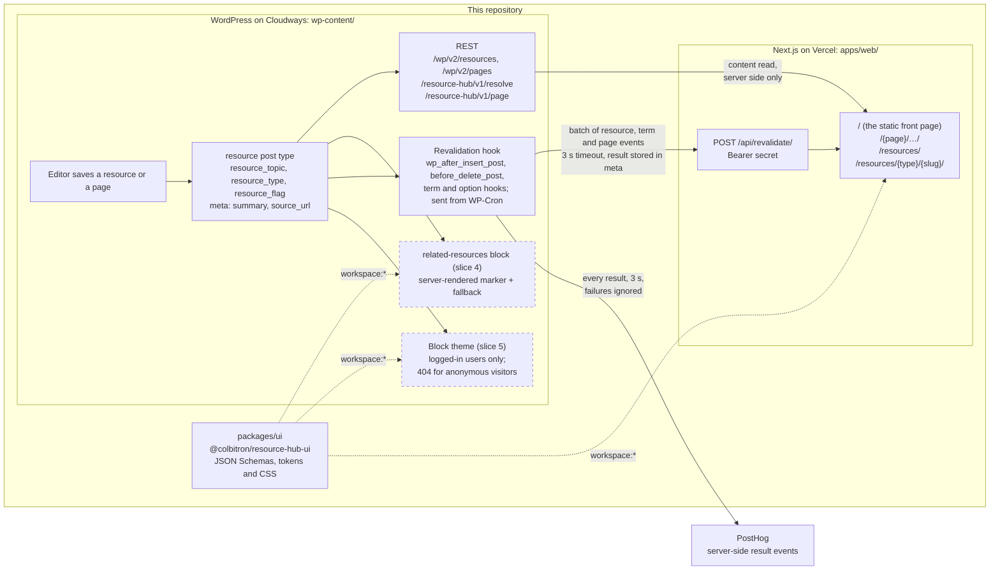

# Resource Hub

A headless WordPress demo in one repository ([ADR 0033](docs/adr/0033-one-repository-for-the-plugin-the-front-end-and-the-contract.md)): a WordPress plugin, `resource-hub`, with the `wp-env` environment it runs in; a Next.js front end on Vercel that reads the site over REST and is told when to revalidate; and the contract package both share. It is a demonstration of a pattern, written fresh, not production code.

The plugin models a filterable resources library: a `resource` post type with `resource_topic`, `resource_type` and `resource_flag` taxonomies, REST-exposed meta (`summary`, `source_url`), two custom REST routes (old-slug resolution and a page lookup by path), and a hook that notifies the front end in batches whenever a public resource, one of its terms or a page changes. The front end renders that library, the CMS's static front page at `/` and every other published page at its path from its own server, and rebuilds pages on demand. The related-resources route and block are the next slice.

## Layout

```
/                                        pnpm workspace root: .wp-env.json, CI, CLAUDE.md, this README
├─ wp-content/plugins/resource-hub-wp/   the WordPress plugin (its own README.md and CLAUDE.md)
├─ wp-content/themes/resource-hub/       the CMS's block theme, planned for slice 5; not here yet
├─ apps/web/                             the Next.js front end (its own README.md and CLAUDE.md)
├─ packages/ui/                          @colbitron/resource-hub-ui: the contract's JSON Schemas and shared styles
├─ docs/adr/                             the hard-to-reverse decisions, one sequence for the whole project
├─ docs/architecture/                    how revalidation and caching work, for contributors
├─ docs/runbooks/                        deploying, rolling back, rotating secrets
└─ .claude/rules/                        path-scoped rules for agents, loaded only when a matching file is touched
```

The planned theme is a full block theme kept in sync with the front end through the `packages/ui` tokens and CSS. Like any theme on this CMS it is for editors and logged-in previews: anonymous visitors get a 404 ([ADR 0031](docs/adr/0031-cms-theme-pages-are-for-logged-in-users.md)).

## Status

Everything marked done exists on `main` and is green in CI.

| Piece | State |
|---|---|
| wp-env environment, PHP 8.4, latest WordPress | done |
| Composer, PSR-4 autoloader, PHPCS, PHPUnit, Playwright | done |
| Block build toolchain (`@wordpress/scripts`) | done |
| GitHub Actions gate | done |
| Hosted CMS on Cloudways, PHP 8.4, HTTPS ([ADR 0005](docs/adr/0005-hosted-wordpress-on-cloudways.md)) | done |
| Deploy job from `main` to the host | done |
| `resource` post type, taxonomies and the one-type rule ([ADR 0007](docs/adr/0007-one-post-type-with-a-type-taxonomy.md), [ADR 0024](docs/adr/0024-type-paths-mirrored-on-both-sites.md)) | done |
| REST-registered meta with sanitizers and an editor panel ([ADR 0008](docs/adr/0008-meta-in-code-not-acf.md)) | done |
| `wp resource-hub seed` and `wp resource-hub decode-slugs` | done |
| The contract package with its schema test, and PHPUnit validating payloads against it ([ADR 0010](docs/adr/0010-contract-as-json-schema-in-a-shared-package.md)) | done |
| Revalidation hook, cron send, editor notice, list column, term notice, status page, PostHog ([ADR 0011](docs/adr/0011-revalidation-fires-on-wp-after-insert-post.md)) | done |
| `GET /resource-hub/v1/resolve` | done |
| CMS lockdown: theme pages for logged-in users only ([ADR 0031](docs/adr/0031-cms-theme-pages-are-for-logged-in-users.md)), XML-RPC off | done |
| Next.js front end: listings, the single resource, the data layer, the revalidate route, the one-pass content renderer, all ISR ([ADR 0043](docs/adr/0043-fetch-cache-with-tags-without-cache-components.md), [ADR 0025](docs/adr/0025-redirects-are-computed-308s-with-no-store.md)) | done |
| The CMS's pages on the front end: the static front page at `/`, every published page at its path, `GET /resource-hub/v1/page` and page events ([ADR 0052](docs/adr/0052-the-front-end-renders-the-cms-pages.md)) | done |
| Front-end production deploy through a Vercel deploy hook ([ADR 0051](docs/adr/0051-front-end-production-deploys-through-a-vercel-deploy-hook.md)); first-deploy check closed 2026-11-06 | done |
| `GET /resource-hub/v1/related/{id}`, `related_picks`, the `resource-hub/related-resources` block's render callback and the front end's related section ([issue #50](https://github.com/Colbitron/resource-hub-wp/issues/50)) | slice 4 |
| CMS block theme | slice 5 |

## Architecture



The front end reads content through the core REST API and the custom routes, always from the Next.js server, so the CMS's address never reaches a browser; it rewrites CMS links to its own domain and CMS images to its `/media/` path. WordPress pushes a small bearer-authenticated batch when content changes, from a cron request after the save, so it never renders pages for the front end and the editor never waits on it; each result is stored on the objects it covered and, when configured, sent to PostHog. The CMS's own theme pages exist only for logged-in users and previews, and answer anyone else with a 404. Both sides take the schemas and the shared styles from `packages/ui` through the pnpm workspace, so a contract change is one pull request; the package is never published. The block and the theme (dashed above) are planned.

## Getting started

Requirements on the host: Docker, Node 24, pnpm. PHP, Composer and WP-CLI run inside the containers.

```sh
pnpm install            # one workspace: the plugin, the front end and packages/ui
pnpm env:start          # WordPress at http://localhost:8888, tests site at :8889
pnpm composer install   # inside the container; vendor/ lands in the plugin directory
pnpm build              # compiles the block and editor scripts into the plugin's build/
pnpm wp resource-hub seed   # optional: fictional sample resources to list and filter
```

Log in at `http://localhost:8888/wp-admin` with `admin` / `password`. The plugin's [README](wp-content/plugins/resource-hub-wp/README.md) has the rest: configuration, the WP-CLI commands and testing. The front end's [README](apps/web/README.md) covers `apps/web`.

## Commands

| Command | Does |
|---|---|
| `pnpm env:start` / `env:stop` / `env:destroy` | wp-env lifecycle |
| `pnpm wp <args>` / `pnpm wp:tests <args>` | WP-CLI in the dev or tests container |
| `pnpm wp resource-hub seed` / `decode-slugs` | The plugin's commands; see its README |
| `pnpm composer <args>` | Composer in the dev container |
| `pnpm lint` / `pnpm lint:fix` | PHPCS / PHPCBF |
| `pnpm lint:js` / `pnpm format` | ESLint and Prettier with the WordPress presets |
| `pnpm build` / `pnpm start` | Block build, once or watching |
| `pnpm test:php` | PHPUnit in the tests container |
| `pnpm test:e2e` / `pnpm test:e2e:debug` | Playwright against the tests site |
| `pnpm test:schemas` | The contract schema test in `packages/ui` |
| `pnpm web:dev` / `web:lint` / `web:typecheck` / `web:test` / `web:test:e2e` / `web:build` | The Next.js app in `apps/web` |

The wp-env scripts run from the root, where `.wp-env.json` is; the rest delegate with `pnpm --filter` to the plugin package or the app, which also accept the same commands from their own directories.

## Testing

Every pull request and every push to `main` runs `.github/workflows/ci.yml`: the CMS gate (the schema test, PHPCS, PHPUnit, then Playwright against the wp-env tests site) and the `web` job (lint, typecheck, unit tests, build, Playwright against a mock CMS). PHPUnit reinstalls the tests site, so it runs before Playwright and the specs activate the plugin themselves; the details are in the plugin's README and `apps/web/e2e/README.md`.

## Deployment

A push to `main` deploys the CMS first, by rsync over SSH from CI after the gate passes, then starts the front end's Vercel production build through a deploy hook once the `web` job has passed too ([ADR 0051](docs/adr/0051-front-end-production-deploys-through-a-vercel-deploy-hook.md)). Pull requests never deploy and get Vercel previews. The secrets, the rollback steps for each side, secret rotation and the host notes are in [`docs/runbooks/deploy.md`](docs/runbooks/deploy.md).

## Decisions

Thirteen records under [`docs/adr/`](docs/adr/) hold the decisions that are expensive to undo. Everything else is explained where it lives: [`docs/architecture/revalidation.md`](docs/architecture/revalidation.md) (how a change reaches the front end), [`docs/architecture/caching.md`](docs/architecture/caching.md) (caching, URLs and redirects, with the measurements), the [deploy runbook](docs/runbooks/deploy.md), the contract in [`packages/ui/README.md`](packages/ui/README.md), and the docblocks.

- [0005](docs/adr/0005-hosted-wordpress-on-cloudways.md) The CMS is hosted on Cloudways so Vercel can reach it over HTTPS; PHP is pinned to 8.4 to match.
- [0007](docs/adr/0007-one-post-type-with-a-type-taxonomy.md) One `resource` post type with a `resource_type` taxonomy, because core REST has no cross-type collection that filters by taxonomy; `featured` is a term in a code-managed `resource_flag` taxonomy, not meta, because term relationships are indexed and `hierarchical` is what keeps editors from creating flags.
- [0008](docs/adr/0008-meta-in-code-not-acf.md) Meta is registered in code with `register_post_meta()`, not ACF, because in a headless build every field is a developer change anyway.
- [0010](docs/adr/0010-contract-as-json-schema-in-a-shared-package.md) The contract is JSON Schema in the shared package, checked by PHPUnit and by Zod, because prose drifts and a schema turns drift into a failing test.
- [0011](docs/adr/0011-revalidation-fires-on-wp-after-insert-post.md) Revalidation fires from `wp_after_insert_post` and `before_delete_post`, the hooks that see terms and meta on every write path, and is sent from a WP-Cron event so the editor never waits.
- [0024](docs/adr/0024-type-paths-mirrored-on-both-sites.md) Resource URLs are `/resources/[type]/[slug]/` on both sites, a resource has exactly one type, and filters and pagination are path segments so every listing can be prerendered.
- [0025](docs/adr/0025-redirects-are-computed-308s-with-no-store.md) Permanent redirects are computed single-hop 308s that a browser is never allowed to keep, because browsers cache header-less redirects and loop when a type changes back.
- [0031](docs/adr/0031-cms-theme-pages-are-for-logged-in-users.md) The CMS's theme pages are for logged-in users only and answer anonymous visitors with a 404, not a redirect, because the front end is the only public site.
- [0033](docs/adr/0033-one-repository-for-the-plugin-the-front-end-and-the-contract.md) One repository and one pnpm workspace hold the plugin, the front end and the contract package, which is never published, with wp-env as the only local environment.
- [0040](docs/adr/0040-the-cms-url-never-reaches-the-browser.md) The CMS URL never reaches the browser: server-side reads, a `/media/` rewrite and one rewriting pass over rendered HTML; exposure, not security.
- [0043](docs/adr/0043-fetch-cache-with-tags-without-cache-components.md) The caching model: the `fetch` Data Cache with tags as the only HTTP cache, cleared by the union of each event's states, with a build that never needs the CMS.
- [0051](docs/adr/0051-front-end-production-deploys-through-a-vercel-deploy-hook.md) The front end's production deploy is a fire-and-forget Vercel deploy hook fired by CI after the CMS deploy and the `web` job.
- [0052](docs/adr/0052-the-front-end-renders-the-cms-pages.md) The front end renders the CMS's pages, learning the tree through one plugin route by path and hearing of changes through a `page` event and one `pages` tag.

## Contract with the front end

[`packages/ui/README.md`](packages/ui/README.md) is the contract's only full statement, with the JSON Schemas in [`packages/ui/schemas/`](packages/ui/schemas/) as the source of truth. The front end reads the core REST API and the custom routes on its server; WordPress POSTs a bearer-authenticated batch of events to `/api/revalidate/`; public URLs are the same on both sites; and a contract change is one additive pull request.

## License

GPL-2.0-or-later.
